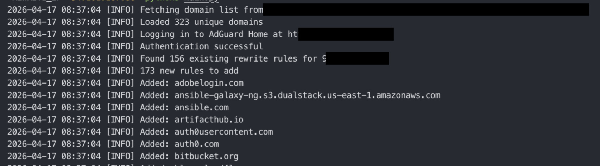

# AdGuard DNS Rewriter

[](https://github.com/hatamiarash7/adguard-dns-rewriter/actions/workflows/ci.yml)
[](https://www.python.org/)
[](LICENSE)

Bulk-add DNS rewrite rules to [AdGuard Home](https://adguard.com/en/adguard-home/overview.html) from a remote domain list.

It fetches a plain-text list of domains, compares it against the rewrite rules already configured in AdGuard Home, and adds only the missing entries — in parallel. Each domain is added together with a `*.domain` wildcard rule, so subdomains are covered too.

## Features

- **Idempotent** — re-running only adds what is missing; existing rules are left untouched.
- **Wildcard coverage** — every `example.com` also installs `*.example.com`.
- **Flexible input** — plain domain lists *and* hosts-file lists (`0.0.0.0 ads.example.com`) are supported.
- **Input validation** — comments, IPs, URLs and malformed lines are filtered out before anything reaches AdGuard.
- **Dry-run mode** — preview exactly what would change, without touching the server.
- **Parallel adds** — configurable worker pool for large lists.

## Requirements

- Python 3.10+
- See [`requirements.txt`](requirements.txt) for pinned dependencies

## Setup

```bash
git clone https://github.com/hatamiarash7/adguard-dns-rewriter.git
cd adguard-dns-rewriter

python -m venv .venv
source .venv/bin/activate

make install          # or: pip install -r requirements.txt
cp .env.example .env  # then edit .env with your values
```

## Configuration

All configuration is read from environment variables (a `.env` file works — the Makefile loads it automatically).

| Variable       | Required | Description                                                 | Default |
| -------------- | -------- | ----------------------------------------------------------- | ------- |
| `ADGUARD_URL`  | yes      | Base URL of your AdGuard Home instance                      | —       |
| `ADGUARD_USER` | yes      | Admin username                                              | —       |
| `ADGUARD_PASS` | yes      | Admin password                                              | —       |
| `REWRITE_IP`   | yes      | IP address (IPv4/IPv6) to rewrite domains to                | —       |
| `DOMAINS_URL`  | yes      | URL of a plain-text domain list (one per line)              | —       |
| `DRY_RUN`      | no       | `true` to preview changes without applying them             | `false` |
| `WORKERS`      | no       | Number of parallel workers (must be ≥ 1)                    | `10`    |
| `LOG_LEVEL`    | no       | Log level: `DEBUG`, `INFO`, `WARNING`, `ERROR`              | `INFO`  |

## Usage

```bash
make dry-run   # preview what would be added -- start here
make run       # apply the rules
```

The Makefile loads `.env` automatically. If you prefer plain Python:

```bash
set -a; source .env; set +a   # export the variables from .env
python main.py
```



<details>
<summary>All make targets</summary>

```text
make help        # list all targets
make install     # install runtime dependencies
make install-dev # install runtime + dev dependencies (tests, linter)
make run         # run the rewriter
make dry-run     # run in dry-run mode (no changes are made)
make test        # run the test suite
make lint        # run flake8 on main.py and tests
make check       # lint + tests
make clean       # remove caches and test artifacts
```

</details>

### Exit codes

| Code | Meaning                                              |
| ---- | ---------------------------------------------------- |
| `0`  | Success (or nothing to do)                           |
| `1`  | Network/API error, or some rules failed to add       |
| `2`  | Invalid or missing configuration                     |
| `130`| Interrupted (Ctrl-C)                                 |

Useful when running from cron or CI: any non-zero code means the sync did not fully succeed.

## Domain list format

One domain per line. The parser is deliberately forgiving:

```text
# Comments (full-line) are ignored
ads.example.com
tracker.example.net   # trailing comments are ignored too

# Hosts-file entries are understood -- the hostname is extracted
0.0.0.0 telemetry.example.org
::1 beacons.example.io
```

Rules applied to each line:

- Lowercased and de-duplicated
- Blank lines and `#` comments (full-line or trailing) skipped
- Hosts-style lines (`<ip> <hostname>`) reduced to the hostname
- Entries that are not valid domains (URLs, bare IPs, single labels like `localhost`) are skipped with a warning
- Each accepted domain also produces a `*.domain` wildcard rule

## How it works

1. Download and validate the domain list (`DOMAINS_URL`).
2. Log in to AdGuard Home and fetch existing rewrite rules pointing at `REWRITE_IP`.
3. Compute the missing rules and add them in parallel (`WORKERS`).

Note: rules already present but pointing at a **different** IP are re-added for `REWRITE_IP`; rules pointing at other IPs are not modified or deleted.

## Development

```bash
make install-dev   # runtime + dev dependencies
make check         # flake8 + pytest
make test          # pytest only
```

Tests use `pytest` with in-memory fakes — no AdGuard instance or network access required. CI runs lint plus the test suite on Python 3.10–3.13 ([workflow](.github/workflows/ci.yml)).

Dependency updates are automated by [Renovate](https://docs.renovatebot.com/) and Dependabot; `requirements.txt` and `requirements-dev.txt` are fully pinned.

---

## Support 💛

[](https://donatebadges.ir/donate/Bitcoin/bc1qmmh6vt366yzjt3grjxjjqynrrxs3frun8gnxrz) [](https://donatebadges.ir/donate/Ethereum/0x0831bD72Ea8904B38Be9D6185Da2f930d6078094)

<div><a href="https://payping.ir/@hatamiarash7"></a></div>

## Contributing 🤝

Don't be shy and reach out to us if you want to contribute 😉

1. Fork it!
2. Create your feature branch: `git checkout -b my-new-feature`
3. Commit your changes: `git commit -am 'Add some feature'`
4. Push to the branch: `git push origin my-new-feature`
5. Submit a pull request

Please run `make check` before opening a pull request.

## Issues

Each project may have many problems. Contributing to the better development of this project by reporting them. 👍
